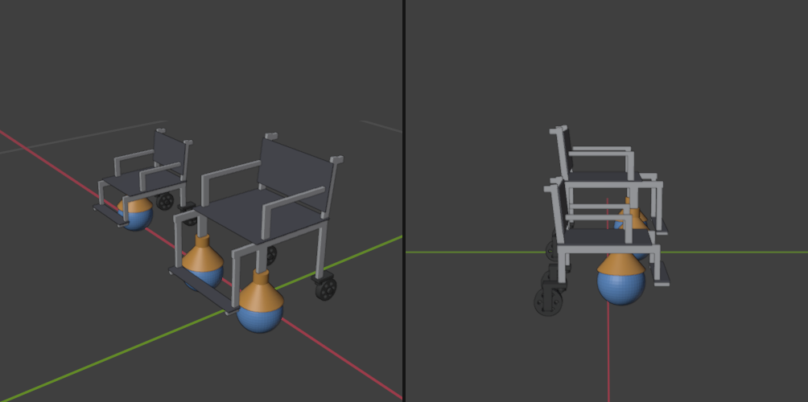

# Supervised autopilot for brain-controlled wheelchairs

**NC State Neurotech Hackathon 2026, ANT Neuro track, Team 2.**

People who can't use a joystick (ALS, high spinal-cord injury, severe cerebral palsy) can choose where to go by looking at a flickering target, read from EEG. Our prototype turns that choice into motion and keeps a co-pilot watching and listening for danger. **The user is always the pilot: the autopilot can stop or pause the chair, but it never starts moving or picks a destination on its own.**



## What it does
1. **Pick a destination with your eyes (SSVEP).** Four flickering targets (Bathroom, Kitchen, Bed, Door). Looking at one makes the visual cortex follow its flicker rate; a CCA decoder on 8 occipito-parietal EEG channels reads which one.
2. **The chair drives there.** A 3D-printed tabletop wheelchair rides on two Sphero BOLT robot balls as its front drive wheels, with swivel casters at the back.
3. **The co-pilot watches and listens.** Camera object detection (YOLOv8) announces "person ahead" and can stop the chair; sound classification (YAMNet) shows big visual alerts for alarms, sirens, doorbells and knocking, for deaf and hard-of-hearing users.
4. **Brake always wins.** One key stops everything, instantly.

Control priority: **brake > user > co-pilot safety stop > autopilot route**.

## Results (subject S1, one session, 24-channel ANT Neuro eego)
- **Destination choice:** 87.5 % correct out of 4 targets with a 4 s look, no calibration (chance 25 %); 90-92.5 % with a 3-minute calibration (TRCA / extended CCA). Our live, causal version of the decoder scores 85 % on the same recording.
- **Brain brake (research in progress):** before the hand moves, EEG separates danger from harmless events only weakly (AUC about 0.67, about 30 % false alarms), so the demo keeps the brake on a key. Full analysis: [`WheelchairBCI/analysis/out/REPORT.md`](WheelchairBCI/analysis/out/REPORT.md).

## How it fits together
```
eego headset --LSL--> ssvep_live.py (flicker + CCA decoder) --"go Kitchen"--> chair_drive.py --Bluetooth--> 2 Sphero BOLTs
                                   GoPro --> vision_assist.py (YOLO) ----stop/alert---^
                                   laptop mic --> sound_assist.py (YAMNet) --> visual alerts
                                   keyboard: arrow keys (backup control), Space = brake
```

## Repository map
| Path | What |
|---|---|
| `src/app/chair_drive.py` | Drives both BOLTs as one chair; arrow keys, brake, decoder commands over LSL (`ChairCommands`) |
| `src/app/ssvep_live.py` | Live destination picker: flicker targets + CCA decoder; `--offline-check` replays a recording |
| `src/app/vision_assist.py` | GoPro / webcam object detection with spoken alerts (`--gopro-usb`) |
| `src/app/sound_assist.py` | Microphone sound alerts with YAMNet |
| `WheelchairBCI/` | Stimulus + recording program and the full offline SSVEP / brake analysis |
| `cad/` | Parametric Blender model, print-ready STLs and assembly guide for the wheelchair |
| `src/stream_replay.py`, `src/record_lsl.py`, `src/cue_session.py` | Replay recordings as live LSL, record LSL, scripted cue sessions |
| `ideas.md`, `docs/decisions.md` | Design notes and decisions |

## Run it
```bash
python -m venv .venv
.venv/Scripts/python -m pip install -r requirements.txt            # core + Sphero + LSL
.venv/Scripts/python -m pip install -r requirements-assist.txt     # optional: camera and sound co-pilot
.venv/Scripts/python -m pytest                                     # tests
```
- Drive with the keyboard: `python src/app/chair_drive.py` (`--sim` without robots)
- Drive with EEG: `python src/app/chair_drive.py --lsl`, then `python src/app/ssvep_live.py` (headset streaming on LSL)
- Camera co-pilot: `python src/app/vision_assist.py --gopro-usb`; sound alerts: `python src/app/sound_assist.py`

## Limitations
Research prototype, not a medical device. One healthy subject, one session. The chair is a tabletop model; the co-pilot only stops or pauses (it doesn't steer around obstacles). Some electrodes (Cz, C4, M2) had poor contact in the recorded session and were excluded.

## Team
Sampath Kasina, Anirudh Bhaskar, Cameron Sheppard, Danil Bogdanov de Carvalho, Tyler Richman, Ethan McMillan.
