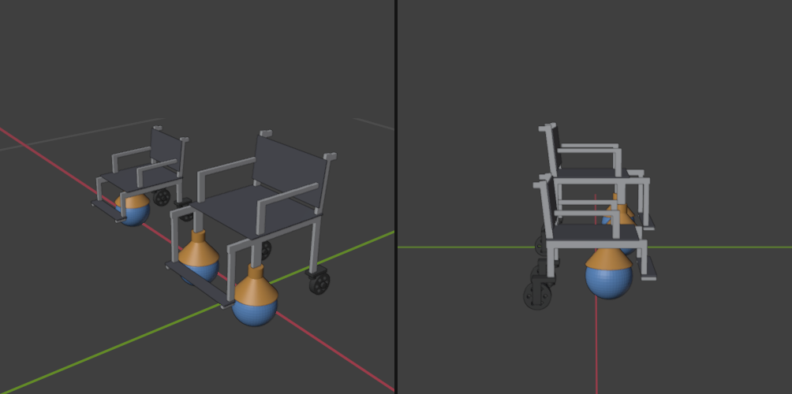

# Sphero wheelchair: print and assembly plan

Tabletop demo of a motorized wheelchair. Two Sphero BOLTs (73 mm balls) are the front drive wheels; two swivel casters trail at the back, so the chair can go forward, back, sideways and turn. The **mini** uses one BOLT at the front centre.

The model is generated by [`wheelchair.py`](wheelchair.py) inside Blender (exec the file); it rebuilds both chairs and rewrites every STL in [`stl/`](stl). Change the numbers at the top of the script, never the STLs. File names end in `_xN` = how many to print.

## Full-size concept (presentation renders, not printed)
`power_chair.py` (run in Blender) models the real-world version: an ordinary folding manual wheelchair plus a **retrofit kit**, because the point is to upgrade the chair people already have rather than sell an expensive power chair. Kit: hub-motor rear wheels on quick-release axles (push rims kept), battery under the seat, controller/compute box on the back of the backrest, forward camera on the front frame, microphone on a push handle, an SSVEP direction screen on a swing-away arm (up/down/left/right arrows, STOP in the middle), anti-tip bars. Renders in `renders/` (hero, side, rear, motor close-up, front close-up, screen close-up over the user's shoulder).

## Key design choices (why it looks like this)
- **Each BOLT sits in a cone "ring", not a grippy cup.** The top of a rolling ball moves at twice the ball's speed, so a high-friction pad would shove the chair forward off the ball. The ring touches the ball only on a thin circle 50 degrees down from its top: the ball spins freely underneath and pushes the ring (and chair) along. A cone seats any ball size, so no fit-test print is needed.
- **Rear wheels swivel.** Fixed rear wheels would scrub sideways whenever the chair turns or strafes. The caster fork pivots on an octagonal pin moulded into each side frame.
- **Glue-only assembly.** Seat, back and footplate have locating ribs that drop between the side frames; the front legs end in tenons that slot into the rings. Glue joints are in shear.
- **Power-chair look.** With the drive balls at the front this reads like a front-wheel-drive power wheelchair (big wheels at the front, casters at the back).

## Overall size
| | Main | Mini |
|---|---|---|
| Footprint (W x L x H) | about 223 x 236 x 258 mm | about 121 x 194 x 190 mm |
| Seat height | 158 mm | 106 mm |
| Plastic | 189 g | 120 g |
| Printer time (PrusaSlicer, CORE One, 0.20mm SPEED, Prusament PLA) | 5 h 24 min | 3 h 46 min |

## Print plan (two CORE One printers in parallel, about 4.5 to 5 h wall-clock for both chairs)
All parts print **without supports**, already oriented (just import, auto-arrange, slice). PLA 1.75 mm, 0.4 nozzle, profile `0.20mm SPEED @COREONE 0.4`, 15% infill, defaults otherwise. The two Ultimaker 2+ take 2.85 mm filament, so they can't run this spool.

| Printer | Plate | Parts | Time |
|---|---|---|---|
| CORE One+ | 1 | `main_side_frame` x2 | 50 min |
| CORE One+ | 2 | `main_seat_pan` + `main_footplate` | about 1 h 35 min |
| CORE One+ | 3 | `main_back_panel` | 43 min |
| CORE One+ | 4 | `mini_seat_pan` + `mini_back_panel` + `mini_footplate` | about 1 h 30 min |
| CORE One | 1 | `main_ring` x2 + all main caster parts (fork x2, wheel x2, wheelcap x2, pivotcap x2) | about 2 h 15 min |
| CORE One | 2 | `mini_side_frame` x2 | 30 min |
| CORE One | 3 | `mini_ring` + all mini caster parts | about 1 h 45 min |

Main chair is complete after about 3 h 10 min. Times are PrusaSlicer estimates for single plates; add a few minutes per plate for heat-up and swapping.

## Assembly (gel superglue, dry-fit every joint first)
1. **Casters:** slide a wheel onto the fork's axle stub, glue a wheelcap onto the stub tip (glue on the stub tip only, keep it off the wheel). Spin-check.
2. **Frame:** stand the two side frames up, glue the seat pan on top of the rails (ribs inside), then the footplate on the foot bars, then the back panel against the front of the back posts.
3. **Rings (main):** put both BOLTs on the table, set a ring on each, lower the chair so the front-leg tenons drop into the ring slots, glue. Gluing on the balls keeps everything level.
   **Ring (mini):** glue the ring's top boss into the round recess under the seat pan.
4. **Casters on:** push each fork's top hole over the octagonal pin under the rear legs, then glue a pivotcap onto the pin tip (pin only; the fork must still swivel).

## Risks (test before committing the print)
- **Can the BOLTs push it?** About 2/3 of the chair's weight sits on the balls (about 65 g per ball for the main chair, plus whatever you put in the seat). Sphero doesn't publish a payload, and the drive slips under load. 5-minute test before printing: rest a light board with about 150 g on two BOLTs plus two toy wheels at the back, and drive.
- **Ring friction:** smooth PLA on the ball's shell. If it drags, rub pencil graphite on the cone. It may scuff the ball's clear shell.
- **Steering both balls together** is a software problem: each ball must be aimed so its "forward" matches the chair's. Untested.
- Nothing has been printed yet; the fit clearances (0.3 mm on ribs/tenons, 0.3 mm on wheel bores) are standard for the CORE One but unverified.
